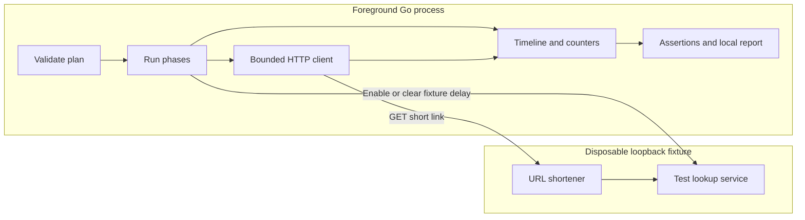

# Breakyard experiment design

The first release is for a Linux developer with a local HTTP service. Its unit of work is one experiment with a declared target, a bounded workload, an expectation, and a recovery check. The first demo asks whether a URL shortener can return the correct destination within a deadline while its lookup service is slow.

## Process and data flow

The demo owns both fixture endpoints and their data. The application and its lookup can share one fixture process. The runner addresses the lookup through a test-only control belonging to that run. For a developer’s own project, start with observation of an explicitly configured local endpoint. Delay injection requires a run-owned test dependency.

| Decision | Reason | When to revisit |
|---|---|---|
| One Go executable and standard-library HTTP, timing, and cancellation | Contributors can trace a request from scheduling to completion. Linux users can start with one binary. | Evaluate an additional library against a concrete measurement or interoperability requirement. |
| Foreground runner | The experiment, its terminal output, and Ctrl-C share a lifecycle. | A daemon becomes useful when users need detached runs and recovery across sessions. |
| Versioned JSON files per run, written locally | A contributor can inspect evidence directly and generate Markdown offline. | Consider SQLite when finding and comparing older runs becomes cumbersome. |

## Proposed CLI

| Command | Contract |
|---|---|
| `breakyard demo` | Start the bundled fixture, run the experiment, show phase changes, and verify cleanup. |
| `breakyard init` | Write a project configuration with explicit local targets and limits. Preserve existing configuration. |
| `breakyard plan` | Validate the configuration and print target, phases, limits, assertions, and cleanup steps without sending traffic or starting fixtures. |
| `breakyard run` | Execute the validated plan in the foreground and return a run ID. |
| `breakyard report <run-id>` | Read a saved run and render Markdown or JSON. Progress goes to stderr so JSON stdout stays parseable. |
| `breakyard compare <before-id> <after-id>` | Compare equivalent windows and identify workload or environment differences that affect the conclusion. |

Project configuration describes the schema version, named local endpoints, allowed operations, deadlines, workload budget, phase durations, and assertions. Use declarative fields with strict validation. Scenario files carry data only. The demo starts with a fixed fixture and schedule so contributors can verify the measurements before introducing configuration.

## One run from start to finish

1. **Preflight.** Validate ownership and exact allowed loopback address, port, and operation. Disable proxy inheritance and redirect following. The shortener’s `Location` header is evidence and can be checked without visiting the destination. Enforce ceilings on duration, requests, concurrency, response bytes, and stored evidence before starting.
2. **Baseline.** Warm both variants from the same fixture snapshot, including the same cached links. Apply a bounded schedule against known links. An unknown link should return the fixture’s declared missing-link response.
3. **Dependency delay.** Record intent, enable the fixture’s temporary delay, and record the actual start time. Continue the same workload. When all workers are occupied, count the missed arrival. Keep the terminal display off the request path.
4. **Recovery.** Clear the delay, verify normal lookup behavior, and observe the recovery window. On cancellation, stop scheduling and cancel pending requests. Give cleanup its own short deadline. Close run-owned listeners and record any resource whose release could not be verified. A runner crash requires a fixture-side expiry for the delay and a bounded fixture lifetime.
5. **Report.** Persist the run ID, scenario version and hash, fixture revision, dataset, configured limits, environment, phase timings, counters, assertion evidence, and cleanup status. Use monotonic elapsed time for durations. Store reports privately under the user’s XDG state directory. Publish complete files by atomic rename and preserve an explicit incomplete status for interrupted runs.

## Reading the evidence

For each phase, report scheduled arrivals, requests started, terminal outcomes, and dropped arrivals. Separate successful redirects, wrong destinations, timeout, cancellation, and transport errors. Show latency percentiles alongside the sample count and the outcomes included. The lookup deadline applies to both variants. The improved shortener can use a known cached destination after its shorter internal lookup budget expires.

An assertion can **pass**, **fail**, or be **unknown** when the required samples or observations are missing. Track execution and cleanup separately. A completed experiment with a failed latency assertion is a valid result. Incomplete data or unresolved cleanup must be visible even when every recorded redirect was correct.

Compare baseline, delay, and recovery windows using the same dataset, schedule, thresholds, and resource budget. Record the intended change in application revision. Flag lower achieved demand, missing windows, or differences in generator placement before drawing conclusions. Exports use named routes and aggregate measurements. Keep request bodies, cookies, credentials, raw queries, and environment variable values out of reports.

## Verification

Use a fake clock for scheduler accounting and real loopback sockets for HTTP behavior. Check correct and wrong redirects, a timeout before headers, insufficient samples, an interrupted write, double cleanup, and cancellation during the delay. A second unrelated local listener must still serve normally after a run. For benchmark results, record machine, OS, runtime, placement, budget, and sample counts. Link each published comparison to its actual report.
